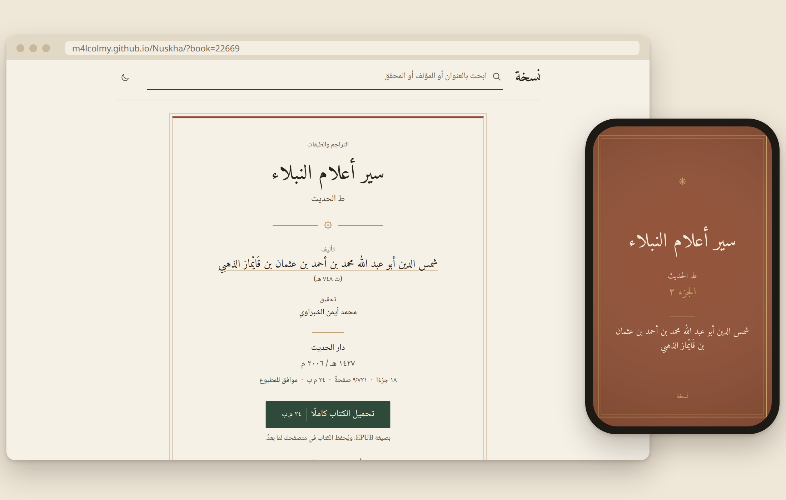
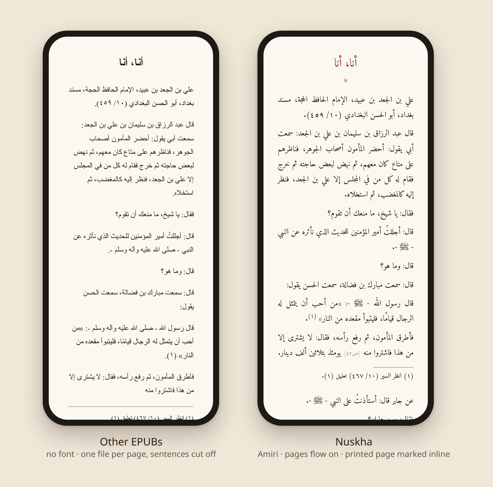
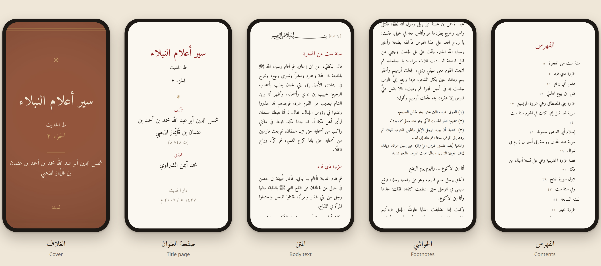
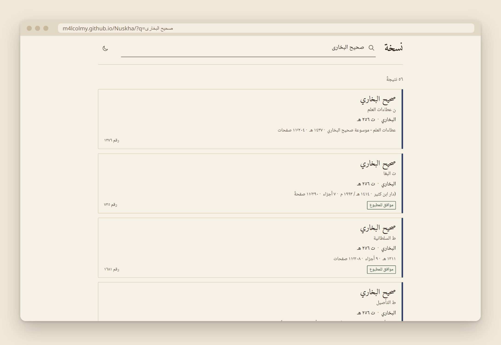
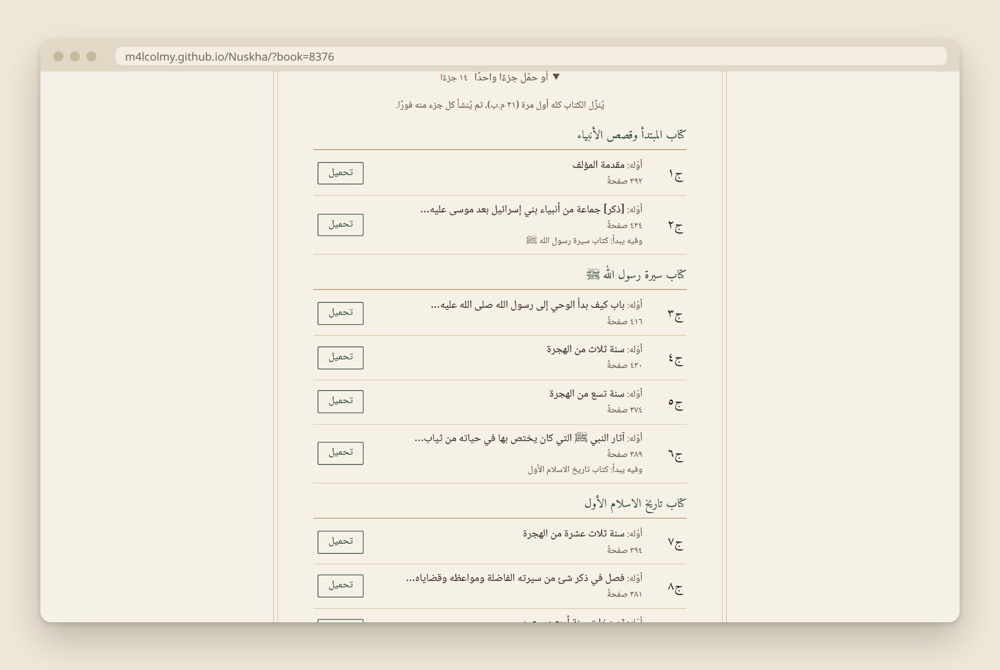
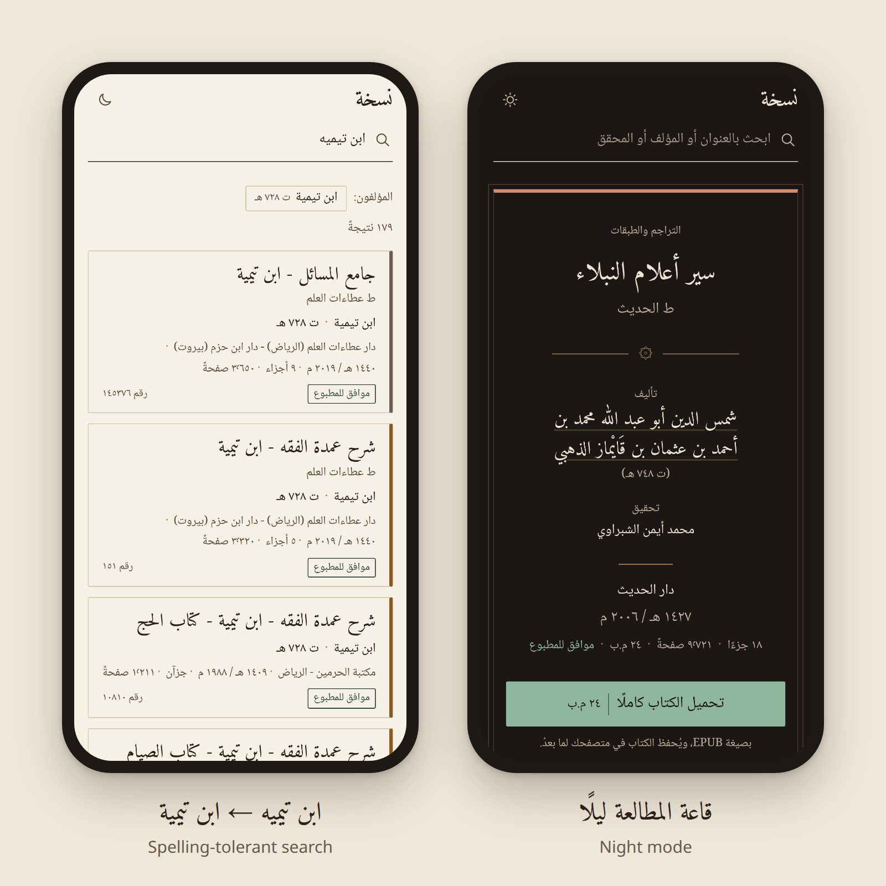
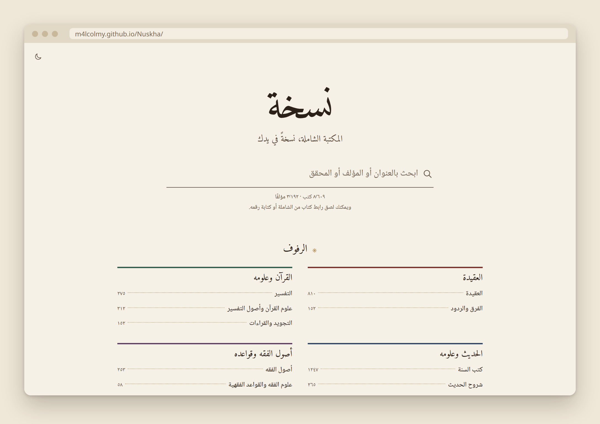

<div align="center">

# نسخة · Nuskha

**المكتبة الشاملة، نسخةً في يدك**

Any Shamela book as a beautiful EPUB for your phone, tablet or e-reader.<br>
Free. No sign-up. No app to install.

### [**→ Open Nuskha**](https://m4lcolmy.github.io/Nuskha/)



</div>

---

## Why Nuskha?

**Shamela** has more than 8,600 books, but you can't take one of them with you.
On shamela.ws you read online, one page at a time. To keep a book you install the whole Shamela
program. Neither gives you a file you can open in Apple Books, Kindle or KOReader.

**Other sites** offer EPUBs of these books, but they are rough copies of the web pages:
no Arabic font, one file per page with sentences cut at the end of each one, and footnotes as plain text.

**Nuskha** makes each book look like a well-printed Arabic book.
Search, tap download, and read it in any EPUB reader.

<p align="center">
  
</p>

|  | Other EPUBs | **Nuskha** |
|---|:---:|:---:|
| Arabic font built in | ✗ | ✓ Amiri |
| Cover, title page and «الفهرس» | ✗ | ✓ |
| Footnotes you can tap | ✗ plain text | ✓ pop-up, with a link back |
| Sentences run on from page to page | ✗ cut at each page | ✓ |
| Printed page numbers, to cite (ج٢ ص١٣٥) | as text only | ✓ plus "go to page" |
| One volume at a time | ✗ | ✓ |

---

## A book you'd want to read

The EPUB is made to look like a printed book, not a web page.

<p align="center">
  
</p>

- **Cover** like a cloth binding, so the book looks right on your shelf.
- **Title page and book card**: author, editor, publisher and edition, as in the printed book.
- **«الفهرس»** with the printed page next to every heading, and a full table of contents in your reader.
- **Amiri font** built in, with tall lines so the vowel marks don't collide.
- **Red headings, quiet page numbers.** «ج٢ ص١٣٥» marks where each printed page starts, so you can cite it.
- **Footnotes** at the end of each page. In readers that support it (Apple Books, KOReader, Kindle) they pop up when you tap them.
- **Right to left** everywhere: pages turn the right way.
- Your reader's own paper, sepia and night modes keep working.

---

## Find any book in seconds

Type the way you normally type. Nuskha knows that أ and ا, ة and ه, ى and ي are the same letter, and it
forgives small typos. «صحيح البخارى» finds صحيح البخاري.

<p align="center">
  
</p>

- Search by **title, author, editor or publisher**.
- Every **edition** is shown with its publisher and year, so you get the one your teacher means.
- **«موافق للمطبوع»** marks the books whose page numbers match the printed edition.
- Paste a **shamela.ws link** or a book number to go straight to the book.
- Browse by **shelves** (الرفوف): العقيدة، التفسير، الحديث، الفقه …

---

## Just the volume you need

Nobody wants every volume of البداية والنهاية just to read one year.
Take the whole book in one file, or a single volume. Each volume shows what it starts with, so you know what is inside.

<p align="center">
  
</p>

The book is kept in your browser after the first download, so a second volume is made instantly, even offline.

---

## Made for your phone

<p align="center">
  
</p>

Works on any phone, tablet or computer, in light or night mode («قاعة المطالعة ليلًا»).

---

## Private and free

- **No account, no ads, no tracking.**
- **Nothing is uploaded.** Your browser fetches the book and builds the EPUB itself. There is no Nuskha server.
- **Always up to date.** The book list is refreshed every week.
- **Open source** (MIT).

<p align="center">
  
</p>

### [**→ Open Nuskha**](https://m4lcolmy.github.io/Nuskha/)

---

## Where the books come from

[turath.io](https://turath.io), a mirror of Shamela.
Book numbers are the same as on shamela.ws.

## For developers

### Run it

You need Node.js 22.18 or newer.

```bash
npm install
```

```bash
npm run dev
```

Then open the link it prints.

### Commands

| Command | What it does |
|---|---|
| `npm run dev` | Start the site locally |
| `npm run build` | Check types and build to `dist/` |
| `npm test` | Run the tests |
| `npm run catalog` | Rebuild the book list from turath |
| `npm run volumes` | Rebuild the volume lists |
| `npm run fonts` | Rebuild the fonts (needs Python, fontTools, brotli) |
| `npm run epubcheck` | Build 4 test books and check them |
| `npm run size` | Show the size of the built site |

### Deploy

Every push to `main` builds and publishes the site (GitHub Pages).
Every Friday the book list and volume lists are refreshed from turath.

### Project layout

- `src/` – the website (Svelte)
- `src/lib/epub/` – the EPUB builder
- `src/lib/search/` – Arabic search
- `scripts/` – data and font scripts
- `.github/workflows/` – deploy and weekly refresh
- `public/data/` – the book list and volume lists
- `tests/` – tests
- `docs/STEPS.md` – the plan
- `docs/screenshots/` – the pictures in this README

## License

MIT
